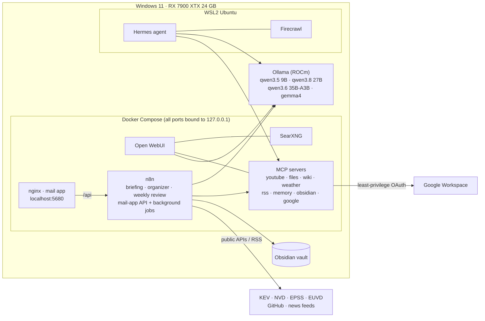

# local-ai-stack

[](https://github.com/DiogoGLAlmeida/local-ai-stack/actions/workflows/ci.yml)

**A private AI assistant that runs on one gaming PC: local LLMs, an agent, 12+ MCP tool servers, and n8n automations that turn email, news, threat intel and code activity into notes and a small web app.**

All inference runs locally on an AMD RX 7900 XTX (24 GB, ROCm), without cloud LLM APIs. The setup is tuned so the PC is still usable for gaming: one model loaded at a time, a short keep-alive, and a one-command "game mode".

> Windows 11 · Ollama (ROCm) · Docker Compose · WSL2 · Open WebUI · MCP · n8n · Obsidian

---

## What it does

| Area | What it does |
|---|---|
| **Chat & research** | Open WebUI with web search (SearXNG), Perplexity-style answers (Vane), TTS (Kokoro), and custom assistants per job (Google, Researcher, Coder, Writer) |
| **Agent** | [Hermes Agent](https://github.com/NousResearch/hermes-agent) in WSL on `qwen3.6:35b-a3b` with 64K context (~62 tok/s, 100% GPU), self-hosted Firecrawl for page extraction, and MCP tools |
| **Coding** | Cline in VS Code on a local `qwen3.8:27b` (32K context) |
| **Tools (MCP)** | Self-hosted MCP servers in Docker: YouTube transcripts, files (read-only), time, Wikipedia, weather, calculator, sequential thinking, RSS, memory, Obsidian, and Google Workspace (Gmail, Calendar, Tasks, Drive, Docs). Docker MCP Toolkit is used for the dev profile (GitHub, Context7…) |
| **Daily briefing** | n8n → Obsidian note every morning: weather, calendar, tasks, important mail, GitHub and CI, new KEV entries and CVEs in my stack, markets, AI and security news, new YouTube videos. Summarised by a 9B model |
| **Gmail organizer** | Weekly: the local model sorts senders into labels and creates **Gmail filters**, so Gmail itself labels new mail. Dry-run first, with a log note and undo steps. Never reads bodies, never sends |
| **Mail app** | A local web app (nginx + n8n webhook API): AI triage ("Needs me"), label tabs with daily digests, threads, summaries, Ask-my-inbox (RAG over search results), a LinkedIn job board scored against my profile, Read later with Firecrawl, keyboard shortcuts |
| **News** | Cybersecurity, Markets (index tiles + news), AI (industry, open models, arXiv) |
| **Threat intel** | CISA KEV + NVD (CVSS) + FIRST EPSS + ENISA EUVD + GitHub advisories + ransomware.live + CISA/CNCS advisories. ATT&CK techniques are AI-suggested and labelled as such. A watchlist flags CVEs in software I run. One click saves a CVE note to Obsidian |
| **Weekly review** | Sunday note: what got done, what's still open, GitHub progress, best job matches, the security week, and next-week focus suggestions (27B model) |

## Architecture



## Design decisions

- **Gaming-safe inference.** `OLLAMA_MAX_LOADED_MODELS=1`, `KEEP_ALIVE=2m` and `NUM_PARALLEL=1`, plus custom Modelfiles with an explicit `num_ctx`. Background jobs only load a model when there is new data. `game-mode.ps1` unloads everything, and `-Full` also stops the containers.
- **Right-sized models.** A 9B model for triage, summaries and the briefing. 27B for tool use (Google, research, code) and the weekly review. A 35B MoE (3B active) for the agent. The small model invented a calendar event once, which is why the Google assistant moved to 27B with a strict system prompt.
- **Least privilege.** The Gmail permissions are read, labels and settings/filters only, with **no send or modify scope**. That's why the organizer creates filters instead of moving mail, and why the mail app is read-only by design. The GitHub token is fine-grained, read-only and limited to selected repos.
- **Local-only surface.**
  - Every container port is bound to `127.0.0.1`.
  - The mail app's API answers only through its own nginx origin: it checks a Host header set by the proxy, a custom header and Sec-Fetch-Site, sets strict CSP, and drops unknown Host headers to block DNS rebinding.
  - n8n's webhook HTML sandbox was **kept on**; the page is served from a separate origin instead of disabling it.
- **Grounded AI output.**
  - Models get structured data and are told to copy facts and never invent them.
  - JSON-mode answers are validated in code: allowed labels only, known IDs only, and a fix for the `"false"`-as-truthy bug.
  - Links and numbers are written by code, not by the model.
  - AI-suggested ATT&CK mappings are labelled "verify".
- **Safe by default.** The Gmail organizer starts in dry-run, caps changes per run, and writes an undo log.

## Lessons learned (selection)

- Docker MCP Gateway rejects browser-extension `Origin` headers and non-`localhost` `Host` headers. Browser extensions therefore use self-hosted servers, and the gateway is used only from the agent and the IDE.
- Some Python MCP servers break on MCP SDK v2. Pinning with `uvx --with "mcp<2"` fixed it.
- Open WebUI tool servers must be the **MCP (Streamable HTTP)** type; the OpenAPI type fails with `/openapi.json` 404s.
- Google Tasks wants `@default` as the list ID. Unverified OAuth apps in "testing" expire weekly, so the app was published to production with its own homepage and privacy policy.
- n8n ≥ 1.103 sandboxes webhook HTML (an opaque origin), which breaks `fetch` from the page. Serving the page from a separate origin keeps the protection.
- Small models in JSON mode sometimes return the string `"false"` instead of the boolean. Validate types explicitly.

## Repo layout

```
docker-compose.yml        all services (Open WebUI, SearXNG, Vane, Kokoro, MCP servers, n8n, mail-app)
.env.example              secrets + folder paths (copy to .env)
setup-ollama.ps1          Ollama env vars + model pulls
hermes/                   Modelfile for the agent model + WSL setup scripts
start-mcp-gateways.ps1    Docker MCP Toolkit gateway (dev profile) as a logon task
update.ps1                monthly update: images, models (keeps custom num_ctx), Hermes
game-mode.ps1             free the GPU for gaming
n8n/                      workflow exports (*.json) + readable source of every code step
mail-app/                 nginx config + the single-page app
docs/SETUP.md             full step-by-step setup guide and troubleshooting
.github/                  CI: secret scan, n8n/Compose validation, ShellCheck, PSScriptAnalyzer
```

## Quick start

1. Install Docker Desktop, Ollama for Windows and WSL2 (Ubuntu). Then run `setup-ollama.ps1`.
2. `copy .env.example .env` and fill it in. See `docs/SETUP.md` for how to get each key.
3. `docker compose up -d`, then open Open WebUI at http://localhost:3000 and n8n at http://localhost:5678.
4. Import the workflows from `n8n/` and publish them. The mail app is at http://localhost:5680.

The full guide is in **[docs/SETUP.md](docs/SETUP.md)**.

## Screenshots

_Add images to `docs/screenshots/` and link them here: the mail app, News, Threat intel, a daily briefing note, and the n8n canvas._

## License

MIT. Third-party services, models and data sources keep their own licenses and terms.
